# BodyTrack ⚖️

**A private, offline-first weight and body-measurement tracker for iOS, Android and the web, built with React Native
and Expo.** No account, no server: your data never leaves your device. The only thing the app may send is an
anonymous crash report, and you can turn that off.

It can also read a food for you: scan its barcode to see, at a glance, whether its fat, saturated fat, sugars and salt
are low, medium or high by official thresholds, with its Nutri-Score, from the open
[Open Food Facts](https://world.openfoodfacts.org) database.

[](https://github.com/Vincicent/BodyTrack/actions/workflows/ci.yml)
[](https://github.com/Vincicent/BodyTrack/actions/workflows/e2e-android.yml)
[](https://github.com/Vincicent/BodyTrack/actions/workflows/e2e-ios.yml)


<p align="center">
  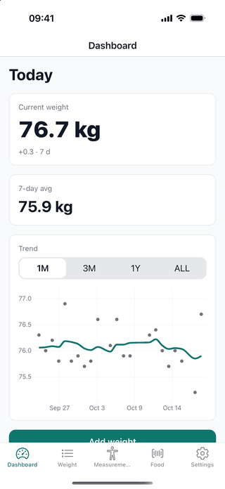
</p>

### On a phone (iOS)

<p align="center">
  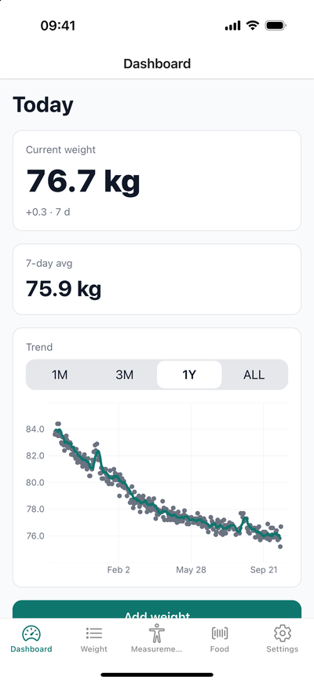
  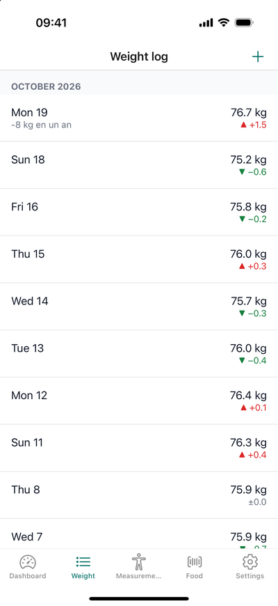
  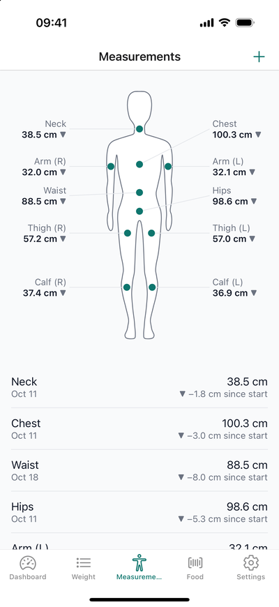
  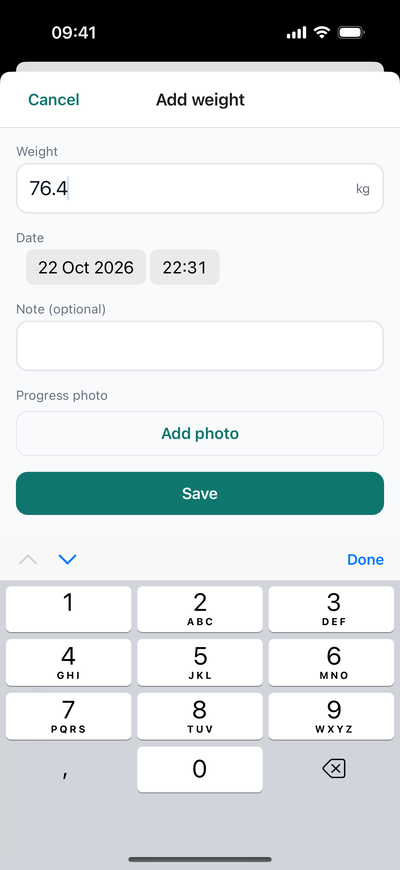
</p>
<p align="center">
  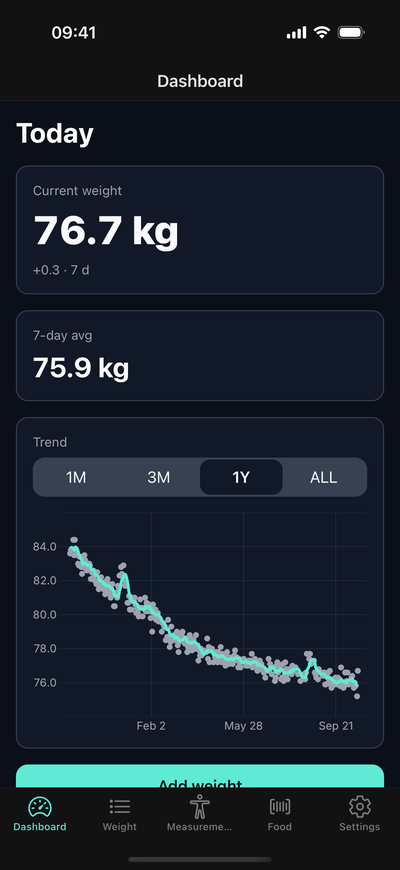
  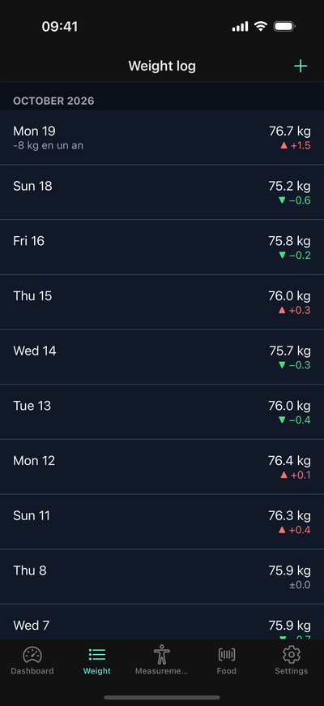
  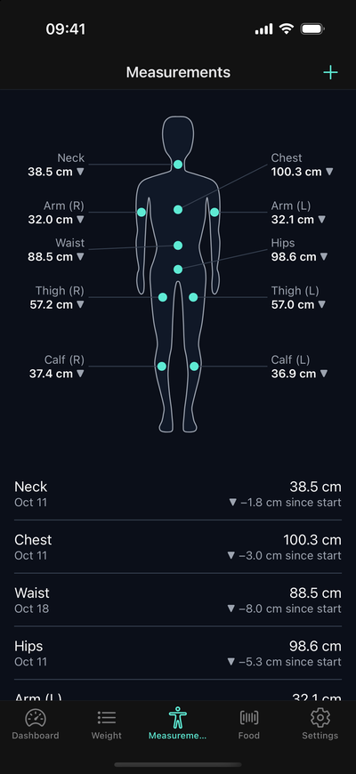
  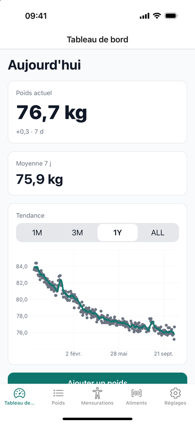
</p>

Progress photo, entry details and row actions:

<p align="center">
  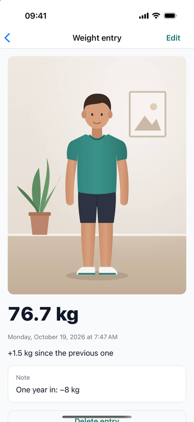
  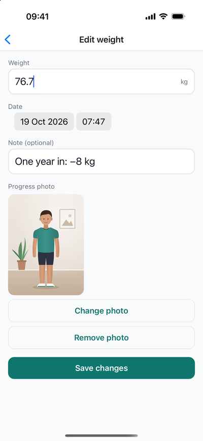
  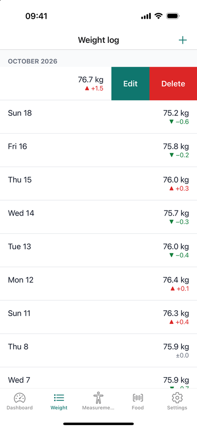
</p>

Food lookup: scan a barcode, get the product, read the analysis (the camera view is simulated: the iOS simulator has no
camera):

<p align="center">
  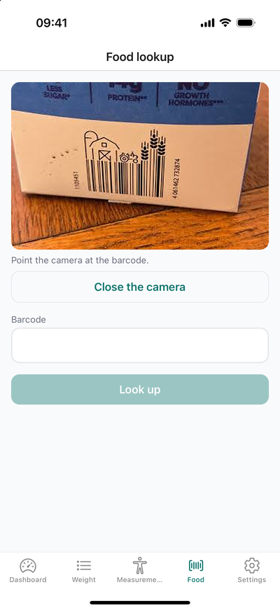
  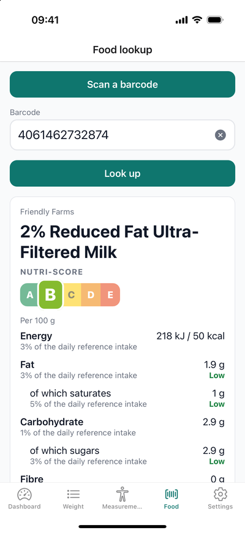
  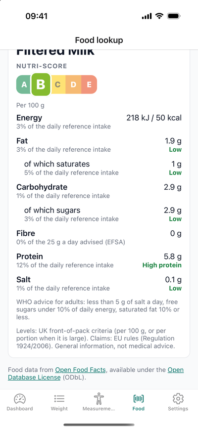
</p>

### On the web (and tablets)

The same code runs in the browser. On a wide screen the layout uses the extra room: two columns on the dashboard, the
body map next to the list.

<p align="center">
  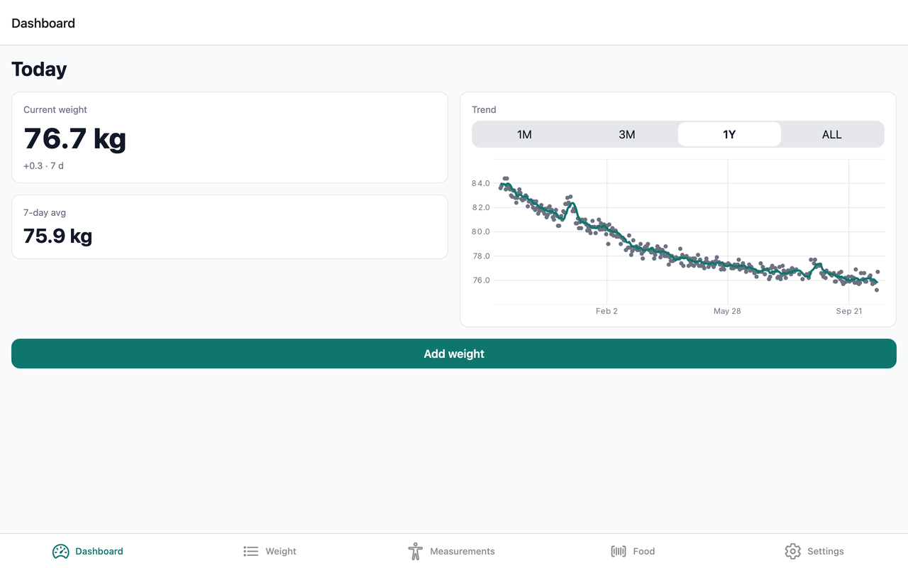
</p>
<p align="center">
  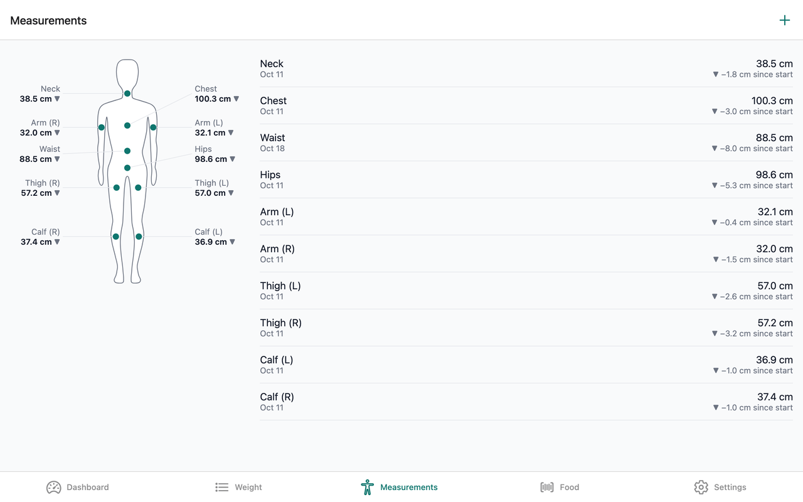
  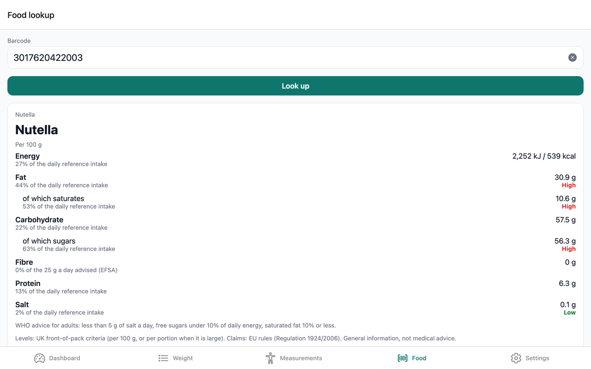
</p>

## Try it

BodyTrack isn't on the stores yet. Run it locally in a few minutes, on iOS, Android or the web: see
[Run it locally](#run-it-locally).

<!-- TODO: link Google Play (and the App Store) here once BodyTrack is published -->

## Features

- **Log your weight** in kg or lb, with date, time, an optional note and a **progress photo**. Any weight is
  accepted, to 10 g in kg: a newborn's 3.25 kg can be tracked as well as an adult's.
- **Progress photos:** picked from the library and shrunk before they're kept (1280 px, JPEG 70%: about 200 KB instead
  of several MB, metadata like location removed); deleted with their entry. Stored on the device only, and not
  available on the web.
- **Entry details:** tap an entry (weight or measurement) to see it in full, with its photo, the change from the
  previous one and its note; **Edit** in the header, **Delete** with confirmation. Swipe left (or long press) for
  Edit / Delete straight from the list.
- **Dashboard:** current weight and 7-day change, 7-day average, and a **trend chart** (1M / 3M / 1Y / all) with a
  moving average that smooths out daily water-weight noise.
- **Weight log** grouped by month, with the change from the previous entry.
- **Body measurements** for 10 sites (neck, chest, waist, hips, and left and right arm, thigh and calf) in cm or in,
  shown on a **body map**: a drawn silhouette with a dot on each site and its latest value, in aligned left/right
  rows. Tap a site for its history, then an entry for its details. A list with the change since your first
  measurement stays below the map.
- **Food lookup:** scan a barcode with the camera (or type it) to get the product from **Open Food Facts**, with fat,
  saturated fat, sugars and salt rated low / medium / high using the official UK front-of-pack thresholds (portion
  rule included), the share of the daily reference intake, and the Nutri-Score.
- **Daily reminder** notification that opens the add-weight screen.
- **CSV export and import** (a full backup: weights and measurements; photos stay on the device) through the share
  sheet; delete-all with confirmation.
- **Light & dark mode**, **English and French**, VoiceOver/TalkBack labels, haptic feedback, and an animated splash
  screen.
- **Phone, tablet and web layouts:** one column on a phone; on a tablet or a wide browser window, the dashboard goes
  in two columns and the body map sits next to the list.
- **Works offline.** Everything you log is stored in SQLite on the device (also in the browser on the web); only the
  food lookup needs a connection, and it sends nothing but the barcode.
- **Anonymous crash reports, opt-out:** if the app crashes, a technical report (the error, the app version, the
  phone model) is sent to Sentry so the bug can be fixed. Never your weights, measurements or anything personal; one
  switch in Settings → Privacy turns it off.

## Tech stack

| Area         | Choice                                                        | Why                                                                                                    |
| ------------ | ------------------------------------------------------------- | ------------------------------------------------------------------------------------------------------ |
| Framework    | Expo SDK 57, React Native 0.86 (New Architecture), React 19.2 | The officially recommended way to build React Native apps; one codebase for 3 platforms                |
| Language     | TypeScript 6, strict                                          | Errors caught before runtime, types shared from database to UI                                         |
| Navigation   | Expo Router                                                   | File-based routes, typed links, deep links and web URLs for free                                       |
| Data         | expo-sqlite + Drizzle ORM, live queries                       | Typed SQL and migrations; screens update by themselves when data changes                               |
| Preferences  | Redux Toolkit + redux-persist                                 | Small, global, persisted state with a predictable structure and DevTools                               |
| Forms        | React Hook Form + zod                                         | Performant forms; one schema validates input and gives the types                                       |
| Server state | RTK Query (Open Food Facts API) + zod                         | Caching, de-duplication, loading and error states for free; the response is validated before use       |
| Camera       | expo-camera                                                   | Barcode scanning with the permission flow handled; typing the code works everywhere, including the web |
| Charts       | Victory Native on Skia                                        | GPU-drawn charts that stay smooth with a year of daily points; Skia also draws the body map            |
| Animation    | Reanimated 4 + Gesture Handler                                | Animations and swipes on the UI thread, not blocked by JavaScript                                      |
| i18n         | i18next + expo-localization                                   | Industry standard; follows the phone's language, switchable in the app                                 |
| Tests        | Jest, React Native Testing Library, Maestro, Playwright       | Each layer tested at the right level (see [Quality](#quality))                                         |
| Delivery     | EAS Build, EAS Update, GitHub Actions                         | Cloud builds, over-the-air JavaScript updates, every pull request checked                              |
| Monitoring   | Sentry                                                        | Crash reports with the real TypeScript line (source maps uploaded by production builds)                |

## Architecture

Code is organised **by feature**, and each feature is split in layers:

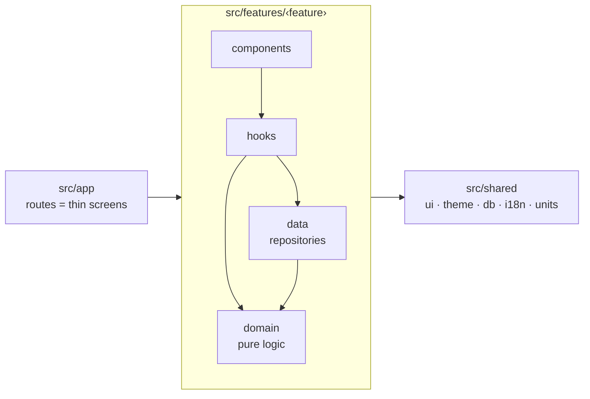

**Dependency rule:** `app → features → shared`. The `domain` layer imports nothing (no React, no database), and
`shared` never imports a feature. Business rules are plain functions, easy to test and to change.

How a new weight travels through the app:

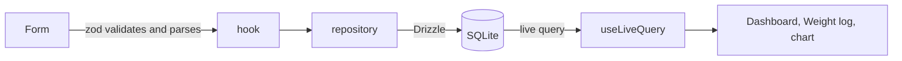

There is no manual refresh: the screens subscribe to the database, so every screen showing that data updates.

## Quality

| Layer                  | What is tested                                                                                   | Tool                         |
| ---------------------- | ------------------------------------------------------------------------------------------------ | ---------------------------- |
| Domain, utilities      | Unit tests, written first: stats, trend, units, CSV, validation                                  | Jest                         |
| Data access            | Repositories on a real in-memory SQLite                                                          | Jest + better-sqlite3        |
| Network                | Real RTK Query store with only `fetch` mocked: found, not found, error + retry, invalid response | Jest                         |
| Components and screens | Queried by role and label, like a user                                                           | React Native Testing Library |
| Navigation             | Routes, deep links, modals                                                                       | expo-router testing library  |
| Mobile app, end to end | 7 critical journeys on a release build, on Android and iOS emulators                             | Maestro                      |
| Web, end to end        | Add a weight, reload (persistence), unit switch                                                  | Playwright                   |

- **390+ unit, integration and component tests**, around **88% line coverage**. Coverage gates in CI: at least
  95% lines and 90% branches for **every** domain file.
- **Every pull request** runs types, lint, tests and coverage, then the Maestro flows on an Android emulator and an iOS
  simulator. `main` is protected: nothing merges unless all of it is green.
- **Accessibility:** WCAG AA contrast in both themes, screen-reader labels on every control and row (the chart's
  trend is read aloud as a sentence), and text that follows the system font size.
- A manual [QA checklist](QA.md) covers what automation can't (real devices, notifications, upgrades).

## Decisions & trade-offs

- **Local-first, no backend.** Health data is personal: keeping it on the device removes accounts, privacy risk and
  running costs, and the app works in airplane mode. The trade-off is no sync between devices; CSV export is the backup.
  The one network feature, the food lookup, reads a public database and sends only a barcode.
- **Crash reports without personal data.** A shipped app needs to know when it breaks, but this one promises privacy,
  so reporting is minimal and in the user's hands: on by default with a clear explanation, off in one tap (which
  stops the SDK, native crashes included). No personal info, no breadcrumbs, no sessions, IP addresses not stored,
  and database errors are stripped of the values they carry. Testers' and users' reports are kept apart
  (`preview` / `production`).
- **Photos are files, the database keeps a path.** A picked photo stays a temporary file until the entry is saved
  (cancelling leaves nothing behind), the database stores a path relative to the app's documents (on iOS the app's
  folder moves with every update, so a full path would break), and a replaced photo is deleted only after the database
  write. Photos aren't in the CSV: a backup stays a small text file.
- **Server state is not client state.** Open Food Facts data is a cache of someone else's truth, so it goes through
  RTK Query (cache, retries, loading/error flags) and is validated with zod at the boundary, instead of hand-written
  `useEffect(fetch)`. Every network state has a screen: loading, found, not found, error with retry.
- **Recognised thresholds, not invented ones.** Nutrition levels follow the UK Food Standards Agency front-of-pack
  guidance and EU reference intakes, so the app judges a product the way its packaging regulations do.
- **SQLite + Drizzle rather than AsyncStorage.** A year of daily entries needs indexes, sorting and range queries;
  Drizzle adds typed queries and versioned migrations. Live queries remove a whole class of "stale screen" bugs.
- **Redux Toolkit for preferences only.** Entries live in the database, which is the source of truth; Redux holds the
  small, global, persisted settings (units, theme, language). Form state stays in React Hook Form, navigation state in
  the URL. Zustand would also fit; RTK was chosen for its structure, DevTools, and how common it is in team codebases.
- **Canonical units.** Weights are always stored in kg and lengths in cm; lb/in exist only on screen. Switching units
  back and forth never changes or rounds a stored value (an end-to-end test checks this).
- **A 7-day moving average, computed before filtering.** Daily weight swings by ±1 kg; the average shows the real
  trend. It is computed on all the data, so the first points of a "1 month" view are not distorted.
- **OTA updates with a fingerprint runtime version.** JavaScript fixes ship in minutes through EAS Update; the
  fingerprint of the native code guarantees an update never reaches a build that can't run it.
- **A drawn body map, and the list kept.** The silhouette is a Skia path, so it scales with the screen and follows
  the theme; site positions and label rows are plain functions, unit-tested. The list stays below it because it is
  quicker to scan and what screen-reader users get on with best.
- **Maestro over Detox** for end-to-end tests: YAML flows with built-in waiting, the same flows on both platforms, and
  no native test harness to maintain.

## Possible evolutions

BodyTrack is complete as a learning project. Directions it could take:

- **Profile:** a screen to set height and goal weight (the dashboard already computes BMI and progress to the goal).
- **Sync across devices,** opt-in: Supabase auth and a background sync with last-write-wins per entry, keeping the
  app fully usable offline.
- **Health platforms:** import from Apple Health / Health Connect, and home-screen widgets.
- **Food diary:** save scanned products to a daily log and follow calories and nutrients alongside weight.
- **A public web version** on EAS Hosting, and progress photos compared side by side over time.

## Run it locally

Requirements: Node 24 (see `.node-version`), Xcode for iOS, Android Studio for Android. BodyTrack uses native modules,
so it needs a development build (Expo Go is not enough).

```bash
git clone https://github.com/Vincicent/BodyTrack.git
cd BodyTrack
npm ci
npx expo run:ios        # or: npx expo run:android, or: npx expo start --web
```

| Script               | What it does                                       |
| -------------------- | -------------------------------------------------- |
| `npm run check`      | Types, lint and tests (run before every commit)    |
| `npm test`           | Unit, integration and component tests              |
| `npm run e2e:mobile` | Maestro flows on the running emulator or simulator |
| `npm run e2e:web`    | Playwright tests on the exported web build         |
| `npm run format`     | Format the code with Prettier                      |

To try it with a year of realistic data, import [`docs/sample-data.csv`](docs/sample-data.csv): Settings → Import CSV.

## Credits

- **Food data** from [Open Food Facts](https://world.openfoodfacts.org), available under the
  [Open Database License](https://opendatacommons.org/licenses/odbl/1-0/) (ODbL). The app credits it with links on the
  Food screen and in Settings → About. The data may contain errors and is general information, not medical advice.

## Author

Built by [**Vincicent**](https://github.com/Vincicent) to learn and demonstrate modern React Native, from the first
screen to the stores.
